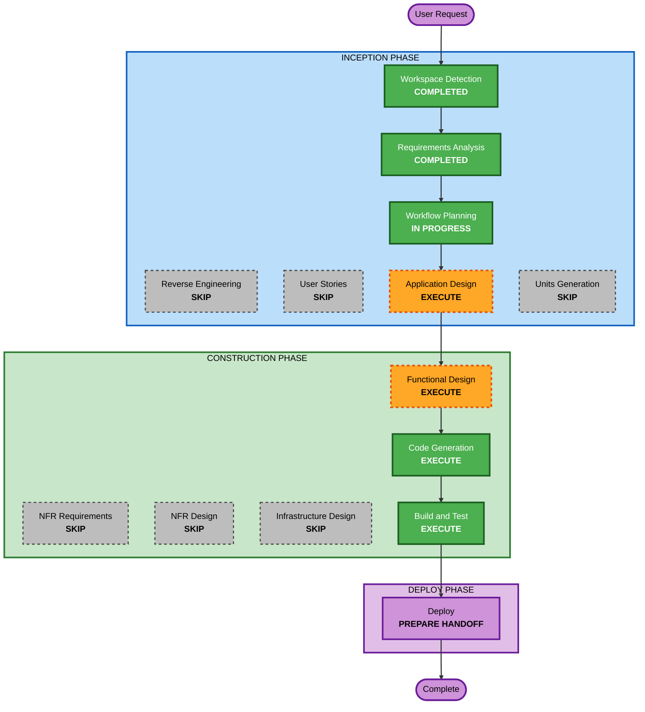

# Execution Plan — StarRocks Query Audit

Intent `20261125-starrocks-query-audit`. Inputs: [requirements.md](../requirements/requirements.md) (approved 2026-11-25), canonical knowledge `aidlc-docs/knowledge/opensource-lakehouse/` (repository design, `workload-foundation`, `jenkins-deployment`).

## Detailed Analysis Summary

### Transformation Scope
- **Transformation Type**: new subproject in an existing data product repository, plus conversion of the repository from the sample template to the `audit` product. No change to the shared helpers' contracts.
- **Primary Changes**: subproject `starrocks` (bronze table definition, silver processing with SQL masking and classification, hourly workflow, gold materialized views, tests); removal of the sample and tpch leftovers; README, AGENTS.md and knowledge renamed for this repository.
- **Related Components**: `notebooks/common/` (used, not changed), `tests/workload_foundation/` (references to deleted sample and tpch code to remove or retarget), `requirements.txt` (drop `duckdb`; possibly add a SQL tokenizer), the platform (paired intent D-1).

### Change Impact Assessment
- **User-facing changes**: Yes. New tables and views for the audit groups; analysts see masked views only.
- **Structural changes**: Yes. New subproject `starrocks`; subprojects `sample` and `tpch` retired.
- **Data model changes**: Yes. New bronze table (filled by this repository's bronze task since the 2026-11-25 change request), silver tables, gold views.
- **API changes**: Yes, one contract: the bronze table schema (`query_id`, `event_time`, JSON `payload`, copy metadata) that the platform's StarRocks task writes and this repository reads (Application Design AD-1).
- **NFR impact**: Yes. Hourly freshness, no lost or duplicated rows, privacy of the full SQL text, fit in one Spark container.

### Component Relationships
- **Primary component**: `starrocks` subproject (new): `workflows/starrocks/`, `notebooks/workload/starrocks/`, `materialized_views/starrocks/`.
- **Shared components**: `notebooks/common/` (`job_runtime`, `cli`, `config_loader`): used as-is.
- **Supporting components**: `tests/`, `Jenkinsfile`, `scripts/code_quality.sh`: CI unchanged; tests retargeted.
- **External dependency**: `opensource-lakehouse-infra` paired intent: `data-products/audit.yaml`, the AuditLoader plugin and 7-day staging table, `SELECT` grants on it, and the `lakehouse_starrocks.connect()` helper the bronze task uses (pull model since the 2026-11-25 change request).

| Component | Change type | Reason | Priority |
|---|---|---|---|
| Repository identity (README, AGENTS.md, requirements, tests) | Minor | Template leftovers break CI and mislead | Critical (blocks the first push) |
| `starrocks` subproject | Major (new) | The intent's purpose | Critical |
| `notebooks/common/` | None | Used as-is | — |
| Platform (paired intent) | Major, other repository | Capture and transfer | Critical for end-to-end; not for this repository's tests |

### Risk Assessment
- **Risk Level**: Medium. Two repositories; the bronze contract must match the platform task; open probe P-1 (connection events in AuditLoader; StarRocks tasks writing to Polaris Iceberg).
- **Rollback Complexity**: Easy. New tables and a new DAG; removing the workflow and views reverts it; no existing consumer.
- **Testing Complexity**: Moderate. Local tests with fixtures and Hypothesis for the masking and classification; end-to-end only after the paired intent.

## Workflow Visualization



### Text alternative
```text
INCEPTION:    Workspace Detection (COMPLETED) -> Reverse Engineering (SKIP)
              -> Requirements Analysis (COMPLETED) -> User Stories (SKIP)
              -> Workflow Planning (IN PROGRESS) -> Application Design (EXECUTE)
              -> Units Generation (SKIP)
CONSTRUCTION: Unit 1 repo-identity: Code Generation -> early push of main and uat
              Unit 2 starrocks: Functional Design (EXECUTE) -> Code Generation
              NFR Requirements, NFR Design, Infrastructure Design (SKIP)
              -> Build and Test (EXECUTE)
DEPLOY:       Deploy handoff (PR request, deploy instructions)
```

## Phases to Execute

### INCEPTION PHASE
- [x] Workspace Detection (COMPLETED)
- [x] Reverse Engineering (SKIPPED) — canonical knowledge covers the shared foundation.
- [x] Requirements Analysis (COMPLETED, approved 2026-11-25)
- [x] User Stories (SKIPPED) — the personas are the standard product groups, and their access is fixed by FR-6.
- [x] Execution Plan (IN PROGRESS)
- [ ] Application Design — EXECUTE
  - **Rationale**: a new subproject and a new cross-repository contract: the bronze table schema and the columns the platform task fills, the silver and gold tables, which notebook owns which table, and how analysts' masked access maps to the MV database. The paired platform intent builds against this design.
- [ ] Units Generation — SKIP
  - **Rationale**: the units follow the repository layout and are fixed here: **Unit 1 `repo-identity`** (FR-8) and **Unit 2 `starrocks`** (FR-3 to FR-5, FR-7). Unit 2 depends on Unit 1 only for a green CI baseline.

### CONSTRUCTION PHASE
- [ ] Functional Design — EXECUTE for Unit 2 `starrocks`; SKIP for Unit 1
  - **Rationale**: Unit 2 has real business rules: SQL literal masking, statement categories, actor types, inferring the data product and environment, deduplication of the copy overlap and the streaming checkpoint, and the gold aggregates. This is where PBT-01 identifies the properties to test. Unit 1 is cleanup with no business logic.
- [ ] NFR Requirements — SKIP
  - **Rationale**: the stack is fixed by the platform (Spark, Iceberg, StarRocks, Python 3.10 lock). PBT-09 framework: Hypothesis, already in `requirements-dev.txt` and used by `tests/workload_foundation/test_properties.py`. Freshness, correctness and resource needs are concrete in NFR-1 to NFR-3 and are designed in Functional Design.
- [ ] NFR Design — SKIP
  - **Rationale**: NFR Requirements skipped; re-run safety and privacy are part of Functional Design.
- [ ] Infrastructure Design — SKIP
  - **Rationale**: this repository owns no infrastructure. The plugin, staging table, `lakehouse_starrocks` helper, product file and grants belong to the paired platform intent, which consumes this intent's Application Design.
- [ ] Code Generation — EXECUTE (ALWAYS), per unit, Unit 1 first
  - **Rationale**: Unit 1 removes the stale workflows and tests, drops `duckdb`, and renames the repository references; after it passes `scripts/code_quality.sh all` and the tests, the first commit is pushed to `main` and `uat` (user decision, FR-8.4). Unit 2 then builds the subproject on a branch.
- [ ] Build and Test — EXECUTE (ALWAYS)
  - **Rationale**: local tests, code quality and workflow validation; dev checks in Jupyter with sample rows; end-to-end only once the paired intent has delivered (otherwise a recorded limitation).

### DEPLOY PHASE
- [ ] Deploy — EXECUTE (ALWAYS)
  - **Rationale**: PR request plus ordered instructions: the paired intent's prerequisites, the `deploy/` notebook that creates the bronze table, the uat then main promotion, and the first hourly runs.

## Canonical Knowledge Impact Inventory
| Canonical path | Action | Requirement and owning component | Reason |
|---|---|---|---|
| `aidlc-docs/knowledge/opensource-lakehouse/application-design.md` | UPDATE | FR-8.2, FR-8.3; repository level | Names `opensource-lakehouse-sample-dp`, subprojects `sample` and `tpch`, `duckdb`, and the sample Initialization path; becomes the audit repository with subproject `starrocks` |
| `aidlc-docs/knowledge/opensource-lakehouse/functional-design/workload-foundation.md` | UPDATE | FR-8.1, FR-8.2; workload foundation | Its "Sample workloads" section describes deleted notebooks; the helper contracts stay |
| `aidlc-docs/knowledge/opensource-lakehouse/functional-design/jenkins-deployment.md` | UPDATE | FR-8.2; CI and deployment | Bundle and job names change from `default` / sample to the `audit` product (`audit-main`, `audit-uat`, `audit/audit_ci`) |
| `aidlc-docs/knowledge/starrocks/application-design.md` | CREATE | FR-3 to FR-7; new `starrocks` subproject | A new subproject; AGENTS.md requires one application design per subproject |
| `aidlc-docs/knowledge/starrocks/functional-design/query-audit.md` | CREATE | FR-3 to FR-5, FR-7, NFR-2, NFR-4; component `query-audit` | One consolidated functional design for the audit pipeline (bronze, silver, gold); a new component boundary because no existing component owns audit data |
| `aidlc-docs/knowledge/tpch/` (application design, `functional-design/medallion-load.md`) | RETIRE | FR-8.1; subproject `tpch` | Code deleted; history kept in the template repository's archives (not in this repository) |
| `aidlc-docs/knowledge/sample/` | RETIRE (does not exist) | FR-8.1 | No canonical path exists; recorded for completeness |
| `aidlc-docs/archive/` | RETAIN (empty) | — | The template's archives were removed with the copy; this intent's archive will be the first |

## Package Change Sequence
1. **Unit 1 `repo-identity`** (this repository): remove `workflows/sample/`, `workflows/tpch/`, `tests/workload_foundation/test_generate_tpch.py`; retarget the other foundation tests away from sample and tpch; drop `duckdb` from `requirements.txt`; rename `opensource-lakehouse-sample-dp` in README, AGENTS.md and the Initialization cell rule; README rewritten for the audit product. Gate: code quality, tests and `lakehouse-validate-workflows .` (if available locally) pass. Then the first commit, pushed to `main` and `uat`.
2. **Paired platform intent** (in `opensource-lakehouse-infra`): may start once this intent's Application Design is approved, since it fixes the bronze contract. It runs in parallel with Unit 2.
3. **Unit 2 `starrocks`** (this repository, branch): Functional Design, then Code Generation.
4. **Integration**: once the platform has delivered `audit.yaml`, the AuditLoader staging table, the grants and `lakehouse_starrocks`, dev checks and then uat.

## Estimated Timeline
- **Stages to execute**: 5 (Application Design, Functional Design, Code Generation for 2 units, Build and Test, Deploy).
- **Estimated duration**: about 2 to 3 working sessions in this repository; end-to-end depends on the paired intent.

## Success Criteria
- **Primary goal**: every StarRocks query, login and platform action is queryable in the audit product's Iceberg tables within about an hour, with full SQL only for owners and developers, and masked views for analysts.
- **Key deliverables**: the `starrocks` subproject (bronze definition, silver processing, hourly workflow, gold views, tests); a clean audit repository on GitHub (`main`, `uat`); the bronze contract for the platform intent; canonical knowledge updated.
- **Quality gates**: `scripts/code_quality.sh all` clean; pytest green, including the Hypothesis properties (PBT-02, -03, -07, -08, -09); workflow and MV files valid; no literal survives masking in the tested properties; re-running the silver load is idempotent.
- **Integration testing**: in dev and UAT after the paired intent; otherwise recorded as a verification limitation.
- **Release handoff**: PR request and ordered deploy instructions.
