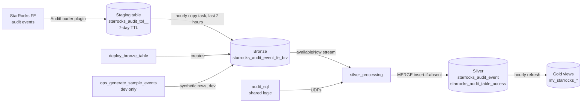

# Component Dependencies — StarRocks Query Audit

## Data flow

Text alternative: StarRocks' FE sends audit events through the AuditLoader plugin into the staging table (7-day TTL). An hourly StarRocks task copies the last 2 hours of staging rows into the bronze table, which the deploy notebook creates (in dev, the sample notebook fills it instead). The silver notebook streams new bronze rows, enriches them with the shared `audit_sql` functions, and merges them into the two silver tables. The gold materialized views refresh hourly from silver.

## Dependency matrix

| Component | Depends on | Kind | Coupling |
|---|---|---|---|
| C1 `audit_sql` | Python standard library | import | none |
| C2 deploy | `notebooks/common/job_runtime`, config | import, config | Owns the bronze contract |
| C3 silver | C1, `job_runtime`, `cli`, config, bronze table, checkpoint key | import, table, checkpoint | Reads only the bronze contract's columns |
| C4 gold | silver tables | SQL | Column names of silver |
| C5 sample | C2's `bronze_schema()`, `job_runtime`, `cli` | import | Same contract as the platform task |
| P3 copy task | bronze table (C2), staging table (P2) | SQL `INSERT` | **The cross-repository contract below** |

## The bronze contract (shared with the paired platform intent)

Table `<catalog>.<namespace>.starrocks_audit_event_fe_brz`, Iceberg `format-version` 2, `write.format.default = parquet` (StarRocks writes only Parquet Iceberg tables), partitioned by `days(event_time)`, append-only.

| Column | Type | Nullable | Filled by the copy task with |
|---|---|---|---|
| `query_id` | string | yes | staging `queryId` |
| `event_time` | timestamp (UTC) | no | staging `timestamp`, converted to UTC if the FE time zone is not UTC |
| `payload` | string (JSON object) | no | every staging column, keys named exactly as in the staging table; credentials in `stmt` redacted with `regexp_replace` (Functional Design BR-20, BR-23) |
| `copied_at` | timestamp (UTC) | no | the copy time |
| `copy_task` | string | no | the task's name (for example `audit_copy_prod`) |

Rules:
- Rows are only appended; the task never updates or deletes them. Duplicates from the 2-hour overlap are expected; silver removes them.
- The JSON keys follow the staging table of the running StarRocks version. The platform builds the key list from the staging table's columns when it creates the task, so a StarRocks upgrade changes only the payload, not the bronze table.
- Silver depends only on `query_id`, `event_time`, `payload` and the payload keys it knows; unknown keys are kept in `payload` without breaking anything.

## Silver contract (consumed by the gold views and by future audit sources)

- `starrocks_audit_event`: `event_key` (unique), `event_type`, `event_time`, `event_date`, `user`, `authorized_user`, `actor_type`, `client_ip`, `fe_host`, `catalog`, `database`, `data_product`, `environment`, `statement_category`, `query_type`, `is_query`, `state`, `failed`, `error_code`, `query_time_ms`, `scan_rows`, `scan_bytes`, `return_rows`, `cpu_cost_ns`, `mem_cost_bytes`, `digest`, `sql_masked`, `sql_text` (full, credentials redacted), `payload` (raw, credentials redacted), `copy_task`, `first_copied_at`, `loaded_at`. Partitioned by `event_date` (identity, so gold views can partition in line; Functional Design BR-41).
- `starrocks_audit_table_access`: `event_key`, `event_time`, `event_date`, `user`, `actor_type`, `statement_category`, `ref_catalog`, `ref_database`, `ref_table`, `data_product`, `environment`. Unique on (`event_key`, `ref_catalog`, `ref_database`, `ref_table`).
- Final column types and nullability: [domain-entities.md](../../construction/starrocks/functional-design/domain-entities.md).

## Communication patterns
- Every hand-off goes through a table; there are no direct calls between schedulers. Each step is restartable on its own: overlap (copy), checkpoint (silver), full refresh (gold).
- Access: owners and developers read the namespace (all tables); analysts read only the MV database (gold, masked) in production.
